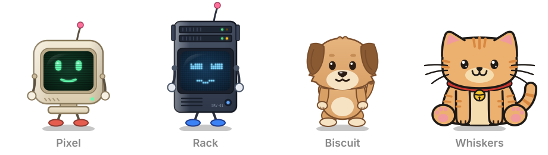

# pet

Little animated pets for your apps: web apps, desktop apps (Electron, Tauri) and websites.

<p align="center">
  
</p>

It idles, blinks, flies around when you drag it, naps in a dock when you leave it alone, and chats
through any AI backend you plug in. Zero dependencies, written in TypeScript.
See it live at [markwylde.com/pet](https://markwylde.com/pet/).

## Install

```sh
npm install @markwylde/pet
```

## Usage

```ts
import Pet, { Whiskers, type Assistant } from '@markwylde/pet'

const pet = Pet({ character: Whiskers, size: 0.8, position: 'bottom-right' })

// Every action returns a promise that resolves false if the user interrupts it
await pet.moveTo('center')
await pet.play('happy')
await pet.say('Hello there!')

pet.play('busy2', { loop: true }) // keep typing until told otherwise
pet.stop() // back to idling

// React to the user
pet.on('click', () => console.log('poked!'))
```

Give it an assistant and clicking the pet opens a chat balloon. Replies can be a string, a promise,
or an async iterable that streams chunks:

```ts
const assistant: Assistant = async function* (messages, { signal }) {
  const res = await fetch('/api/chat', {
    method: 'POST',
    headers: { 'content-type': 'application/json' },
    body: JSON.stringify({ messages }),
    signal,
  })
  const reader = res.body!.pipeThrough(new TextDecoderStream()).getReader()
  for (;;) {
    const { value, done } = await reader.read()
    if (done) break
    yield value
  }
}

pet.set({ chat: { assistant, suggestions: ['What can you do?'] } })
```

The [library README](packages/pet/README.md) covers the full API: docking and auto-hide, persisting
state, theming, React bindings, custom animations and custom characters.

## Repository

| Path | What |
| ---- | ---- |
| [`packages/pet`](packages/pet) | **`@markwylde/pet`**, the library. |
| [`apps/demo`](apps/demo) | A playground: every animation, every character, a mock streaming assistant, a tray dock. |
| [`apps/site`](apps/site) | The landing page at [markwylde.com/pet](https://markwylde.com/pet/). |

See [CONTRIBUTING.md](CONTRIBUTING.md) to run them locally.

## License

MIT © Mark Wylde
